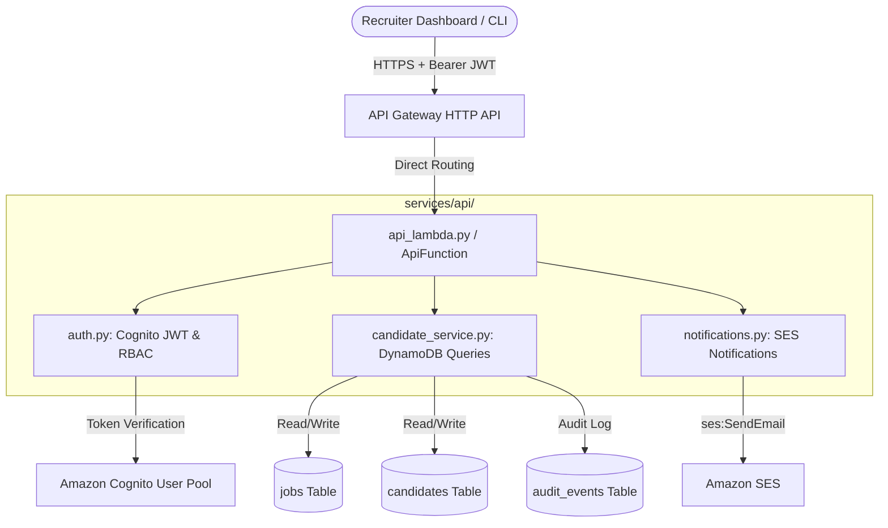

# Backend APIs, Cognito Auth & SES Notifications Guide
**Owner**: Aryan (Backend APIs, Cognito Auth & SES Notifications)  
**Collaborators**: Prasanna (Frontend), Shashank (Infrastructure & Reliability), Sasi (NLP), Chiranthan (Scoring), Virajith (Ingestion)  
**Version**: 1.0  

---

## 1. Module Overview

The Backend API module (`services/api/` and `api_lambda.py`) serves as the central orchestration and management surface for recruiters, administrators, and client applications. It integrates with:
1. **Amazon Cognito**: User authentication, JWT claim validation, and Role-Based Access Control (RBAC).
2. **Amazon DynamoDB**: Candidate pipeline queries, job requisition management, recruiter decisions, and audit logging.
3. **Amazon SES**: Automated transactional emails for candidate invitations, status notifications, and recruiter alerts with strict PII sanitization.
4. **CSV Export Engine**: RFC-4180 compliant shortlist reporting for talent acquisition workflows.

---

## 2. Architecture & Data Flow



---

## 3. Authentication & RBAC (`auth.py`)

### 3.1 Cognito Configuration
The infrastructure stack provisions:
- **`CognitoUserPool`**: Configured with email sign-in, password policies, and standard attributes.
- **`CognitoUserPoolClient`**: Web client configured with SRP and password auth flows without client secret for browser/SPA integration.

### 3.2 Role-Based Access Control (RBAC)
User groups are mapped from the `cognito:groups` JWT claim:
| Role | Permissions | Endpoints Allowed |
| :--- | :--- | :--- |
| **`Admin`** | Full access to manage jobs, candidates, audit logs, and trigger emails. | `*` (All endpoints) |
| **`Recruiter`** | Read jobs, list candidates, update recruiter decisions, download CSV shortlist, send candidate emails. | `GET /jobs`, `POST /jobs`, `GET /jobs/*`, `PATCH /jobs/*/candidates/*`, `GET /jobs/*/shortlist.csv`, `POST /notifications/send` |
| **`Reviewer`** | Read-only candidate review access. | `GET /jobs`, `GET /jobs/{id}`, `GET /jobs/{id}/candidates`, `GET /jobs/{id}/candidates/{id}` |

### 3.3 Authorization Header
Requests must supply a standard Bearer token:
```http
Authorization: Bearer <ID_TOKEN_OR_ACCESS_TOKEN>
```
For local testing and offline CI execution, `ENABLE_AUTH_MOCK=true` allows requests without live Cognito credentials.

---

## 4. REST API Specification

### 4.1 Jobs API

#### `GET /jobs`
Lists all job requisitions.
- **Query Parameters**:
  - `status` *(optional)*: Filter by job status (`ACTIVE`, `PAUSED`, `CLOSED`).
- **Response (200 OK)**:
```json
{
  "data": [
    {
      "job_id": "job_2026_001",
      "title": "Cloud Solutions Architect",
      "department": "Engineering",
      "location": "Remote",
      "status": "ACTIVE",
      "required_skills": ["AWS", "Python", "DynamoDB"],
      "min_experience_years": 3,
      "created_at": "2026-09-17T00:00:00Z"
    }
  ],
  "count": 1
}
```

#### `POST /jobs`
Creates a new job requisition. Requires `Admin` or `Recruiter` role.
- **Request Body**:
```json
{
  "title": "Senior DevOps Engineer",
  "department": "Platform Engineering",
  "location": "New York, NY (Hybrid)",
  "required_skills": ["Terraform", "Kubernetes", "AWS", "CI/CD"],
  "preferred_skills": ["Go", "Datadog"],
  "min_experience_years": 5
}
```
- **Response (201 Created)**:
```json
{
  "data": {
    "job_id": "job_a1b2c3d4",
    "title": "Senior DevOps Engineer",
    "department": "Platform Engineering",
    "status": "ACTIVE",
    "created_at": "2026-09-17T08:00:00.000Z"
  },
  "message": "Job created successfully"
}
```

#### `GET /jobs/{jobId}`
Retrieves details for a single job requisition.

---

### 4.2 Candidates API

#### `GET /jobs/{jobId}/candidates`
Retrieves all applicants for a given job, ordered by `score_total` descending.
- **Query Parameters**:
  - `status` *(optional)*: Filter by pipeline processing status (`PARSED`, `SCORED`).
  - `decision` *(optional)*: Filter by recruiter decision (`PENDING`, `SHORTLIST`, `INTERVIEW`, `REJECT`, `HIRED`).
  - `min_score` *(optional)*: Minimum overall score threshold (e.g. `75.0`).
- **Response (200 OK)**:
```json
{
  "data": [
    {
      "candidate_id": "cand_0001",
      "job_id": "job_2026_001",
      "score_total": 86.5,
      "processing_status": "SCORED",
      "recruiter_decision": "PENDING"
    }
  ],
  "count": 1,
  "job_id": "job_2026_001"
}
```

#### `GET /jobs/{jobId}/candidates/{candidateId}`
Retrieves complete extracted candidate profile and AI score breakdown conforming to `docs/TEAM_INTEGRATION_GUIDE.md` Section 4.
- **Response (200 OK)**:
```json
{
  "data": {
    "candidate_id": "cand_0001",
    "job_id": "job_2026_001",
    "parsed_profile": {
      "name": "Sarah Jenkins",
      "email": "sarah.jenkins@example.com",
      "phone": "+1 (555) 234-5678",
      "skills": ["AWS", "DynamoDB", "Lambda", "Python", "SQS", "Terraform"],
      "job_titles": ["Cloud Support Associate", "Systems Engineer"],
      "employers": ["Apex Cloud Solutions", "CloudCorp Inc."],
      "experience_years": 3.5,
      "links": {
        "linkedin": "https://linkedin.com/in/sarahjenkins-cloud",
        "github": "https://github.com/sjenkins-dev"
      },
      "confidence": {
        "overall": 0.94,
        "name": 0.99,
        "skills": 0.91,
        "job_titles": 0.92,
        "employers": 0.93
      },
      "flags": []
    },
    "score_total": 86.5,
    "score_breakdown": { "skills": 100.0, "title": 85.0, "experience": 100.0 },
    "matched_skills": ["AWS", "DynamoDB", "Lambda", "Python"],
    "missing_skills": ["Docker"],
    "processing_status": "SCORED",
    "recruiter_decision": "PENDING"
  }
}
```

#### `PATCH /jobs/{jobId}/candidates/{candidateId}`
Updates recruiter decision status and notes, records an audit event in `audit_events`, and optionally dispatches an automated SES notification.
- **Request Body**:
```json
{
  "decision": "SHORTLIST",
  "notes": "Excellent AWS proficiency and clear cloud architecture background.",
  "send_notification": true,
  "job_title": "Cloud Solutions Architect"
}
```
- **Response (200 OK)**:
```json
{
  "data": {
    "candidate_id": "cand_0001",
    "job_id": "job_2026_001",
    "recruiter_decision": "SHORTLIST",
    "recruiter_notes": "Excellent AWS proficiency and clear cloud architecture background.",
    "decision_updated_at": "2026-09-17T08:15:00.000Z"
  },
  "message": "Candidate decision updated to SHORTLIST",
  "notification": {
    "status": "SENT",
    "message_id": "msg_0a1b2c3d",
    "template": "INTERVIEW_INVITATION",
    "recipient": "s***********s@example.com"
  }
}
```

#### `GET /jobs/{jobId}/shortlist.csv`
Generates and downloads an RFC-4180 CSV export of all shortlisted or high-scoring candidates.
- **Headers Returned**:
  - `Content-Type: text/csv; charset=utf-8`
  - `Content-Disposition: attachment; filename="shortlist_{jobId}.csv"`
- **Export Columns**:
  - `Candidate ID`, `Name`, `Email`, `Phone`, `Experience (Years)`, `Total Score`, `Skills Score`, `Title Score`, `Experience Score`, `Matched Skills`, `Missing Skills`, `Processing Status`, `Recruiter Decision`

---

### 4.3 SES Notifications API

#### `POST /notifications/send`
Directly dispatches transactional email notifications to candidates or recruiters.
- **Request Body**:
```json
{
  "recipient_email": "sarah.jenkins@example.com",
  "template_type": "INTERVIEW_INVITATION",
  "context": {
    "candidate_name": "Sarah Jenkins",
    "job_title": "Cloud Solutions Architect",
    "top_skills": "AWS, Python, Terraform"
  }
}
```
- **Available Templates**:
  - `INTERVIEW_INVITATION`: Formal interview invite with skill highlights.
  - `APPLICATION_REJECTION`: Courteous notification of application closure.
  - `RECRUITER_ALERT`: Digest highlighting top AI-screened talent.

---

## 5. Security & PII Protection

1. **Email Redaction**: All logged recipient addresses are masked according to Technical Spec v1.0 Section 9:
   - `candidate@example.com` $\rightarrow$ `c*******e@example.com`
2. **Phone Redaction**: All logged phone numbers preserve only the trailing 4 digits:
   - `+1 (555) 234-5678` $\rightarrow$ `***-***-5678`
3. **IAM Least Privilege**: SAM execution role policies explicitly bind only required SES actions (`ses:SendEmail`, `ses:SendRawEmail`, `ses:SendTemplatedEmail`) without wildcard `Action: '*'`.
4. **CORS Enforcement**: Standard CORS headers (`Access-Control-Allow-Origin: *`) are returned across all HTTP methods.
